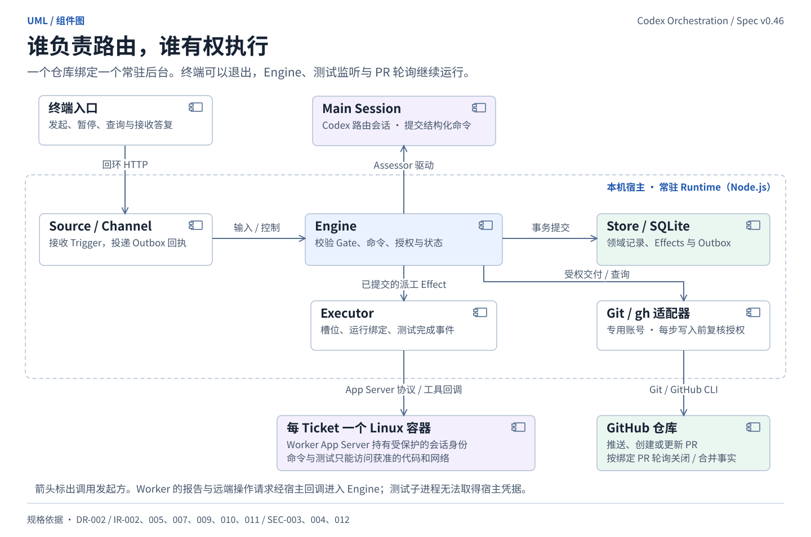
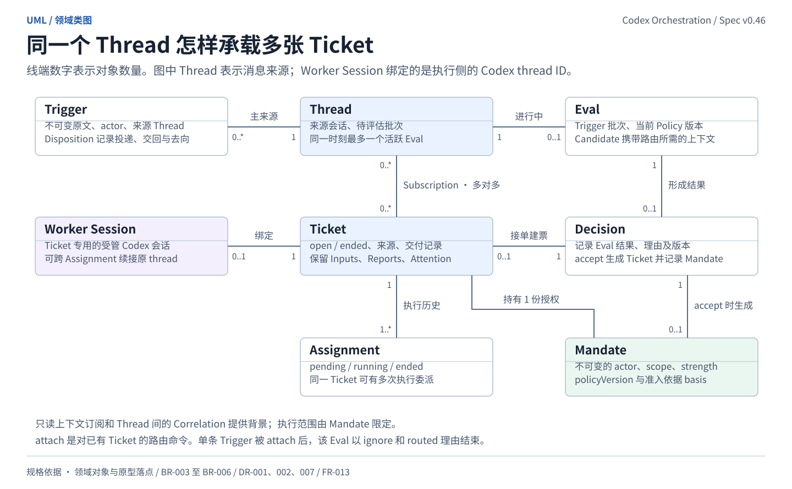
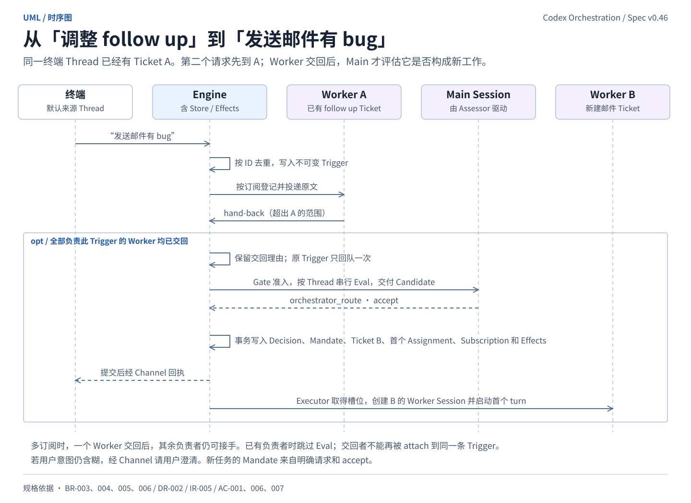
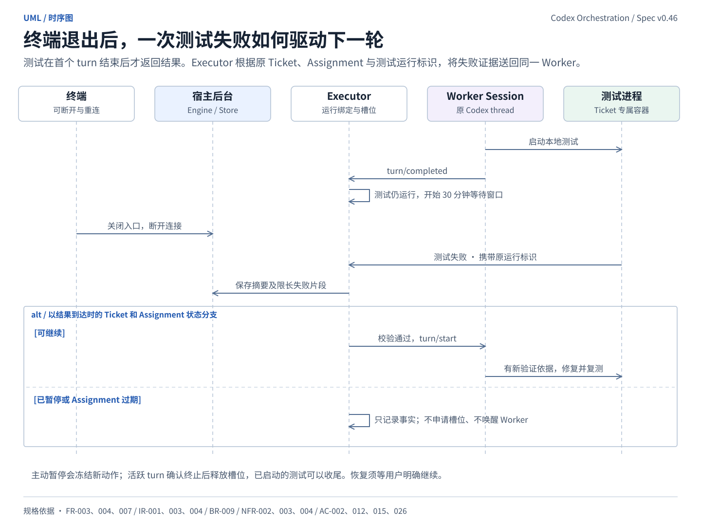
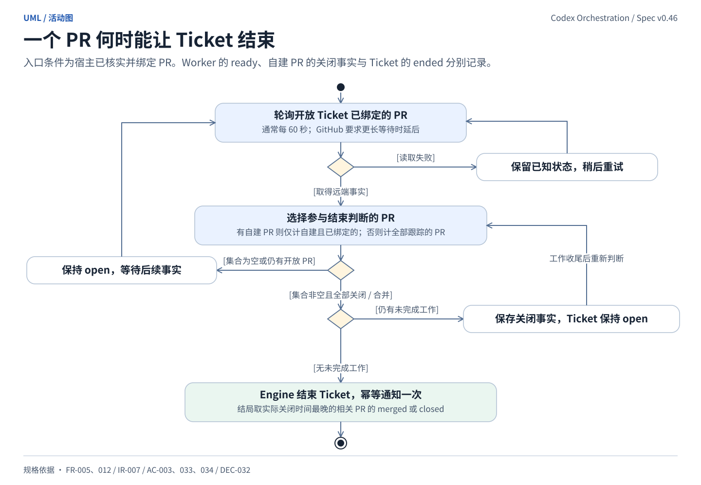
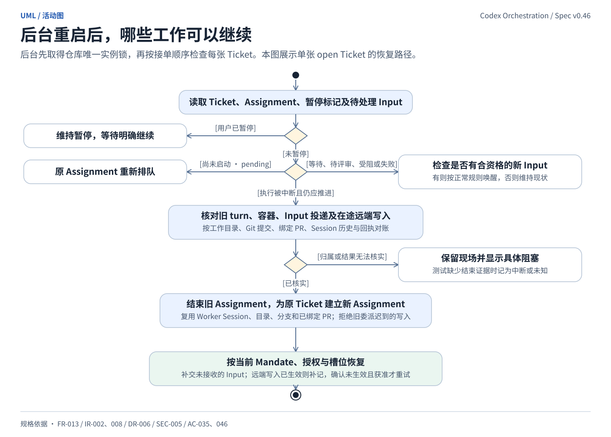

# 本地 Codex agent 架构图集

这六张 UML 图对应[规格 v0.46](../../spec.md)。要理解为什么用户可以只开一个终端，先看消息路由和后台接续两张时序图。前者解释谁来判断一条新消息的归属，后者解释终端离线后什么事件有权唤醒已有工作。每张图底部列出了可回查的规格或验收条款。

| 视图 | 要回答的问题 | SVG 尺寸 |
| --- | --- | --- |
| [组件图](01-components.svg) | 谁可以判断路由、写领域状态、执行代码或操作 GitHub？ | 1440 × 955 |
| [领域类图](02-domain.svg) | 一个来源 Thread 如何关联多张 Ticket？授权和执行委派各自属于谁？ | 1440 × 890 |
| [消息路由时序图](03-routing.svg) | 已有 follow up 工单时，为什么同一入口还能接下邮件 bug？ | 1440 × 1050 |
| [后台接续时序图](04-continuation.svg) | 关闭终端后，测试失败如何回到原 Worker？哪种情况下只记录结果？ | 1440 × 1080 |
| [PR 收尾活动图](05-pr-lifecycle.svg) | 有多张 PR 或仍有人工追问时，哪个事实决定 Ticket 结束？ | 1440 × 996 |
| [重启恢复活动图](06-restart.svg) | 哪些工作应排队、等待、续接或阻塞？丢失的回执如何对账？ | 1440 × 1030 |

## 组件与领域对象

参考原型中，Engine 管理领域写入，Assessor 驱动 Main Session，Executor 为每张 Ticket 管理 Worker。本地设计将执行侧换成 Codex App Server，在每张活跃 Ticket 的 Linux 容器里运行；Git 推送和 PR 写入由宿主使用专用账号逐步校验并执行。这些隔离边界需要在实现阶段验证。[原型架构](https://github.com/deepseek-ai/dsh-superagent-prototype/blob/8c32a9d/docs/007-architecture.md)

## 消息路由与后台接续

图中的 Channel 回执和 Worker 启动都依赖接单事务提交。图画出其中一种先后顺序，二者各自按已登记的操作执行。遇到多个订阅者时，Engine 跟踪每个负责者对同一条 Trigger 的处理结果。只读上下文订阅不会让该 Worker 成为这条追问的负责者。[原型接收与扇出](https://github.com/deepseek-ai/dsh-superagent-prototype/blob/8c32a9d/src/core/intake.ts) · [原型负责者判定](https://github.com/deepseek-ai/dsh-superagent-prototype/blob/8c32a9d/src/core/model.ts)

## 交付与恢复

Worker 可以先用 draft PR 保存有价值的部分成果。完成自审和相关检查后，Worker 提交 ready Report 并关联可访问的 PR。此时 Ticket 仍为 open，直到满足图中结束条件。原型在 Ticket 层选择应计入的 PR，并在未完成工作收尾后重新判断。[原型 Worker 指引](https://github.com/deepseek-ai/dsh-superagent-prototype/blob/8c32a9d/prompts/work.md) · [原型 Ticket 结束规则](https://github.com/deepseek-ai/dsh-superagent-prototype/blob/8c32a9d/src/core/tickets.ts)

恢复时保留原工作身份；新 Assignment 用来区分中断前后的执行。原型也为重启后的 Worker 提供恢复说明。本地规格还要求核实 Codex 会话绑定、已送达的 Input 和 GitHub 写入结果，防止重复执行。[原型重启行为](https://github.com/deepseek-ai/dsh-superagent-prototype/blob/8c32a9d/docs/003-execution.md#restart)
